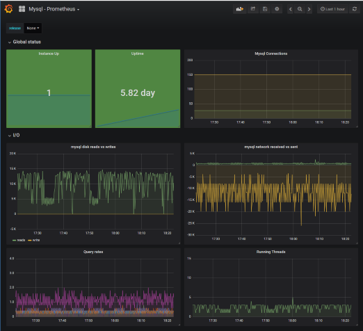
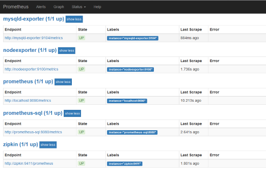

# Docker Files

## Shape Files

The API image does not contain the shape files (`files/`, about 290 MB on
disk). In Cloud Run they come from the GCS bucket mounted at
`/mnt/data/shapes` (`ShapeConfiguration:ShapeRootDirectory` in
`appsettings.CloudRun.json`). Everywhere else `ShapeRootDirectory` is
`../../files`, which resolves to `/files` inside the container, so mount the
repository's `files/` folder there. The API docker-compose files below already
do this with a read-only volume:

```yaml
    volumes:
      - "../files:/files:ro"
```

To run the image on its own, from the repository root:

```bash
make test-data
docker run --rm -p 5000:5000 \
  -e ASPNETCORE_ENVIRONMENT=Docker -e ASPNETCORE_URLS=http://*:5000 \
  -v "$(pwd)/files:/files:ro" \
  stuartshay/microservice-api:latest
```

`make test-data` extracts the git-ignored Individual Landmark & Historic
District building `.dbf` from its committed zip; without it that one shape
can't be read.

## Local Mode

```
cd docker
docker-compose -f docker-compose-local.yml -f docker-compose-metrics.yml -f docker-compose-logging.yml -f docker-compose-tracing.yml pull
docker-compose -f docker-compose-local.yml -f docker-compose-metrics.yml -f docker-compose-logging.yml -f docker-compose-tracing.yml up
```

### Destroy

```
docker-compose -f docker-compose-local.yml -f docker-compose-metrics.yml -f docker-compose-tracing.yml down
docker volume prune
```

## Cluster Mode

```
make certificates
cd docker
docker-compose -f docker-compose-cluster.yml pull
docker-compose -f docker-compose-cluster.yml up --scale api=4
```

`make certificates` creates a self-signed certificate for local development.
The generated certificate and private key are intentionally excluded from Git.

## Grafana UI

```
http://grafana:3000
```

### Documentation

<https://grafana.com/>



## Prometheus

```
http://prometheus:9090
```

```
Targets
http://prometheus:9090/targets

Graph
http://prometheus:9090/graph

```

### Prometheus Documentation

<https://prometheus.io/>



## Tag & Push Google Cloud Repository

Tag

```
docker tag  5eab36ab4873  \
us-east4-docker.pkg.dev/velvety-byway-327718/microservice-api/microservice-api:5.0.1-build.113
```

Push

```
docker push us-east4-docker.pkg.dev/velvety-byway-327718/microservice-api/microservice-api:5.0.1-build.113
```
